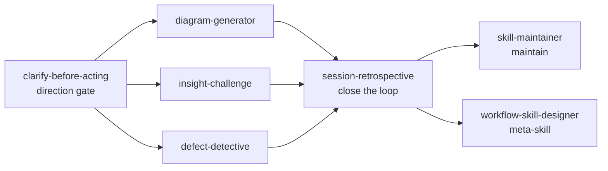

# agent-skills

Original, platform-neutral agent skills — prompt assets that work across Claude Code, Codex, Cursor, OpenCode, Windsurf, Gemini, GitHub Copilot, CodeBuddy, and Hermes.

[English](README.md) | [简体中文](README.zh-CN.md)

[](https://skillhub.cn/user/user_95900c57)
[](https://clawhub.ai/@yumingtao)
[](https://skills.sh/yumingtao/agent-skills)
[](https://cdn.jsdelivr.net/gh/yumingtao/agent-skills@main/docs/market/index.json)
[](LICENSE)

No runtime dependencies, no network calls, no build step. Each skill is a self-contained folder of instructions; where a skill supports multiple platforms, the platform files are thin adapters that route every agent to the same shared behavior.

These skills were extracted from day-to-day development: each was used on real work, and its rules were written down here once they held.

Eight skills live in this repository. Seven are complete on their own and, installed together, sit on one engineering loop; see "Use one, or run them as a loop" below. `public-push-check` checks a push to a public remote. It stays in this repository and on the skills.sh index. It is not published to SkillHub or DSH.

## Skills

| Skill | What it does |
|---|---|
| **[diagram-generator](skills/diagram-generator/)** | Turns architecture briefs and codebase notes into standalone HTML/SVG technical maps: system, implementation, infrastructure, trust, data movement, deployment, and process views. Full package: generation rules, planning IR, HTML template, validation script, per-platform smoke tests. |
| **[clarify-before-acting](skills/clarify-before-acting/)** | A behavior rule for non-trivial requests: do your own homework first, reuse answers already in memory, work a question queue one item at a time until every direction-changing unknown is resolved, and never guess where direction is at stake. |
| **[insight-challenge](skills/insight-challenge/)** | Adversarial verification of code-review findings. Challenges each claim with counter-evidence anchored to actual source code and emits structured verdicts — overturned / weakened / confirmed — instead of trusting findings as-is. |
| **[workflow-skill-designer](skills/workflow-skill-designer/)** | Meta-skill that designs orchestrator + phases workflow skills: a thin `SKILL.md` coordinator plus progressively loaded `phases/` files, with TodoWrite patterns, inter-phase data flow, and validation checklists. |
| **[defect-detective](skills/defect-detective/)** | The first stop before fixing a bug — read-only triage for a defect signal (bug report, stack trace, or log) that answers: is this a known issue, who owns it, and what changed. Normalizes a stable fingerprint, searches the tracker for duplicates cross-stack, correlates recent changes when the implicated layer is known, and infers the owning team with an auditable evidence chain. Upstream of fix-it skills (triage, not repair); strictly read-only, with a ready-to-paste ticket draft but never files or mutates anything. Smoke-tested against a real Jira tracker (dedup hit and no-match paths) plus git blame correlation. |
| **[session-retrospective](skills/session-retrospective/)** | End-of-session retro that logs development-workflow issues (wrong answers, skipped gates, wrong routing, MCP errors, skill/doc gaps, multi-turn corrections) as enum-validated JSONL signals — a recurring issue is a rule gap and its priority escalates; when nothing went wrong, one success entry, never fabricated. One phrase enters Fix Mode: items ordered by recurrence and priority, per-item proposals, one confirmation per item with an append-only audit trail, running from the log alone across sessions. Ships a zero-dependency validation script (Node 18+) that machine-checks log health and recurrence groups. The signal-data layer: machine-aggregable output, complementary to report- and memory-style retro skills. Smoke-tested on a real session across both the main path and the corrupted-line exception. |
| **[skill-maintainer](skills/skill-maintainer/)** | Edits a skill that already exists. It does not score one. It proposes one gap and writes only after confirmation. Any directory with SKILL.md can be maintained. |
| **[public-push-check](skills/public-push-check/)** | Checks the commits about to be pushed to a public remote: secrets, author identity, the README when a change is user-visible, and security issues in the diff. The author and the committer must be the allowlisted person. An AI author fails. A git push typed in a terminal does not run it. Not published to SkillHub or DSH. |

<a id="alone-or-together"></a>

## Use one, or run them as a loop

Install any one skill and it finishes its own job. Installed together, they sit on one engineering loop: an arrow is an optional handoff, and you stop at the station the task needs.



Arrows are handoffs. When an upstream skill is absent, the current skill continues under its own rules.

| Station | Skill | On its own | Together |
|---|---|---|---|
| Direction gate | [clarify-before-acting](skills/clarify-before-acting/) | Resolves goal, constraints, success, and context, then hands off a task contract | When direction is unclear, pass through it before any execution station |
| Execution | [diagram-generator](skills/diagram-generator/) | Turns a brief into a standalone HTML/SVG diagram | When the lens or scope is unclear, pass through the gate first |
| Execution | [insight-challenge](skills/insight-challenge/) | Turns one review finding into overturned / weakened / confirmed | At session end, systemic misjudgments go to the closer |
| Execution | [defect-detective](skills/defect-detective/) | Read-only answer to whether it is known, who owns it, and what changed, plus a ticket draft | A thin fingerprint goes through the gate first; a mis-triage goes to the closer; freezing the pipeline as a team workflow goes to the meta-skill |
| Closer | [session-retrospective](skills/session-retrospective/) | Writes this session's systemic misses to JSONL, and can fix them one by one | Any working session can be logged; a recurring gap can go to maintenance |
| Maintenance | [skill-maintainer](skills/skill-maintainer/) | Checks an existing skill against the TRACE bands and proposes one gap | A retro entry, an evaluation comment, or a structure check can hand work to it; a new skill still goes to the meta-skill |
| Meta-skill | [workflow-skill-designer](skills/workflow-skill-designer/) | Designs an orchestrator + phases skill package | Turns a loop that keeps recurring into a new skill. The generated skill runs its own phases |

Three combinations you can follow as written:

- Fix a bug: when direction is unclear, start with `clarify-before-acting`, then `defect-detective`. Filing and the fix stay on your own write path. Close the session with `session-retrospective`.
- Check a review finding: `insight-challenge` emits the verdict. A misjudgment is logged to `session-retrospective` at session end.
- Turn a repeated process into a skill: a gap that keeps showing up in `session-retrospective` goes to `workflow-skill-designer`.
- Change a skill that already exists: hand an evaluation comment, a recurring log entry, or "按 TRACE 过一遍" to `skill-maintainer`, and write only after confirmation.

Before a push to a public remote, run `public-push-check`. It is not a station on this loop, and it is not published to SkillHub or DSH.

## Install

Each skill is standalone — copy or symlink only what you need.

### Claude Code

```bash
ln -s /absolute/path/to/agent-skills/skills/<skill-name> ~/.claude/skills/<skill-name>
```

### Codex (skill mode)

```bash
ln -s /absolute/path/to/agent-skills/skills/<skill-name> ~/.codex/skills/<skill-name>
```

### Other agents

- **diagram-generator** ships per-platform adapters: `AGENTS.md` (Cursor / OpenCode / Windsurf), `GEMINI.md`, `COPILOT-INSTRUCTIONS.md`, `CODEBUDDY.md`, `HERMES.md` — see its [README](skills/diagram-generator/README.md#installation).
- The other seven skills are Claude-skill-format folders; on platforms without a skills mechanism, point the agent at the skill's `SKILL.md` as an instruction file.

### SkillHub (Community Marketplace)

Install any skill directly from [SkillHub](https://skillhub.cn/user/user_95900c57):

```bash
# Install the CLI once
curl -fsSL https://skillhub.cn/install/install.sh | bash

# Install a skill (namespace: user_95900c57)
skillhub install yumingtao-diagram-generator --namespace user_95900c57
skillhub install yumingtao-clarify-before-acting --namespace user_95900c57
skillhub install yumingtao-insight-challenge --namespace user_95900c57
skillhub install yumingtao-workflow-skill-designer --namespace user_95900c57
skillhub install yumingtao-defect-detective --namespace user_95900c57
skillhub install yumingtao-session-retrospective --namespace user_95900c57
skillhub install yumingtao-skill-maintainer --namespace user_95900c57
```

### ClawHub (OpenClaw official registry)

Install any skill from the [ClawHub](https://clawhub.ai/@yumingtao) global registry:

```bash
# Install the CLI once
npm i -g clawhub

# Install a skill (owner: yumingtao)
clawhub install yumingtao/diagram-generator
clawhub install yumingtao/clarify-before-acting
clawhub install yumingtao/insight-challenge
clawhub install yumingtao/workflow-skill-designer
clawhub install yumingtao/defect-detective
clawhub install yumingtao/session-retrospective
clawhub install yumingtao/skill-maintainer
```

### skills.sh (decentralized GitHub index)

No sign-up required — skills are indexed directly from this public repository. Install via the `skills` CLI:

```bash
# Install all eight skills at once
npx skills add yumingtao/agent-skills

# Or install a single skill
npx skills add yumingtao/agent-skills --skill diagram-generator
npx skills add yumingtao/agent-skills --skill clarify-before-acting
npx skills add yumingtao/agent-skills --skill insight-challenge
npx skills add yumingtao/agent-skills --skill workflow-skill-designer
npx skills add yumingtao/agent-skills --skill defect-detective
npx skills add yumingtao/agent-skills --skill session-retrospective
npx skills add yumingtao/agent-skills --skill skill-maintainer
npx skills add yumingtao/agent-skills --skill public-push-check
```

### DeepSeek Harness (DSH)

Each skill ships as its own npm bundle, so you can install only what you need. Pick one of the two methods below.

#### Method 1 — npm packages (recommended; per-skill install)

```bash
dsh plugin --profile web add yumingtao-diagram-generator
dsh plugin --profile web add yumingtao-clarify-before-acting
dsh plugin --profile web add yumingtao-insight-challenge
dsh plugin --profile web add yumingtao-workflow-skill-designer
dsh plugin --profile web add yumingtao-defect-detective
dsh plugin --profile web add yumingtao-session-retrospective
dsh plugin --profile web add yumingtao-skill-maintainer
```

On first boot of the web profile each bundle copies its skill directory into
`~/.agents/skills` (the user-global skill root shared by DSH and Codex CLI).

#### Method 2 — market index (add all seven at once)

Add the market index, then install any skill. Pick one index URL:

```bash
# Option A — jsDelivr CDN (recommended; may cache `@main` for minutes to hours)
dsh plugin index add https://cdn.jsdelivr.net/gh/yumingtao/agent-skills@main/docs/market/index.json

# Option B — GitHub raw (always fresh, no CDN cache)
dsh plugin index add https://raw.githubusercontent.com/yumingtao/agent-skills/main/docs/market/index.json

# Option C — local file (for offline / development)
dsh plugin index add file:///path/to/agent-skills/docs/market/index.json
```

Install:

```bash
dsh plugin install diagram-generator
dsh plugin install clarify-before-acting
dsh plugin install insight-challenge
dsh plugin install workflow-skill-designer
dsh plugin install defect-detective
dsh plugin install session-retrospective
dsh plugin install skill-maintainer
```

> With the market index, skill content is fetched from `github.com/yumingtao/agent-skills` at the pinned commit recorded in the index, regardless of which index URL you use. The CDN/raw choice only affects how the index file itself is delivered.

## Sync

`sync/` is a generalized "one source → many platforms" distributor for the whole collection. A platform target receives the canonical skill folder as a symlink (default) or as a materialized copy.

```bash
sync/apply.sh --dry-run                                  # preview
sync/apply.sh                                            # link into every detected platform
sync/apply.sh --platform claude --skill insight-challenge # narrow scope
sync/apply.sh --to ./ --platform cursor                  # project-local install
sync/check.sh                                            # verify nothing drifted
```

The distribution map lives in `sync/manifest.sh` — see [sync/README.md](sync/README.md).

## Design principles

- **One source of truth per skill.** Platform files route; they never restate behavior.
- **Markdown-first.** A skill is instructions plus optional specs/resources — nothing to install or run.
- **Progressive loading.** Coordinators stay thin; execution detail lives in `phases/` / `specs/` / `references/` loaded on demand.

## Roadmap

- [ ] `drawio-first` output mode for `diagram-generator` (needs dedicated mxGraphModel rules, a template, and import validation)

## License

[MIT](LICENSE). Skills in this collection are released under the same MIT terms.
