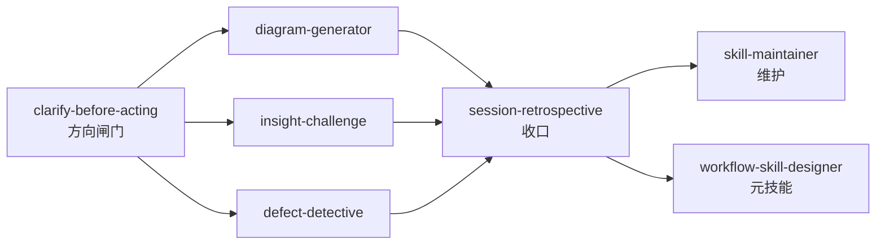

# agent-skills

原创、平台中立的 agent skills —— 可在 Claude Code、Codex、Cursor、OpenCode、Windsurf、Gemini、GitHub Copilot、CodeBuddy、Hermes 上工作的提示词资产。

[English](README.md) | [简体中文](README.zh-CN.md)

[](https://skillhub.cn/user/user_95900c57)
[](https://clawhub.ai/@yumingtao)
[](https://skills.sh/yumingtao/agent-skills)
[](https://cdn.jsdelivr.net/gh/yumingtao/agent-skills@main/docs/market/index.json)
[](LICENSE)

零运行时依赖、零网络调用、零构建步骤。每个 skill 都是一个自包含的指令文件夹；当一个 skill 支持多平台时，平台文件只是薄适配层，把所有 agent 引向同一份共享行为。

这些技能从日常开发里收出来：先在真实工作中用，规则稳定后再写进仓库。

本仓库有八个技能。其中七个各自完整，只安装一个就能用；装在一起时，它们落在同一条工程环上，见下方「单独使用，也可以串起来」。`public-push-check` 检查发往公开远端的推送。它留在本仓库里，也会被 skills.sh 索引。它不发布到 SkillHub，也不发布到 DSH。

## Skills

| Skill | 功能 |
|---|---|
| **[diagram-generator](skills/diagram-generator/)** | 将架构简介（architecture brief）与代码库笔记转化为独立 HTML/SVG 技术图：系统图、实现图、基础设施图、信任边界图、数据流转图、部署图、流程图。完整包：生成规则、规划 IR、HTML 模板、校验脚本、逐平台冒烟测试。 |
| **[clarify-before-acting](skills/clarify-before-acting/)** | 面对非平凡请求的行为规则：先自行调研、复用记忆中已有的答案、按问题队列逐个提问直到所有影响方向的未知项全部澄清、方向上绝不靠猜。 |
| **[insight-challenge](skills/insight-challenge/)** | 对代码审查发现的对抗式验证。用锚定到实际源码的反证逐条质询每个发现，输出结构化裁决 —— overturned（推翻）/ weakened（削弱）/ confirmed（确认）—— 而不是照单全收。 |
| **[workflow-skill-designer](skills/workflow-skill-designer/)** | 设计 orchestrator + phases 结构化 workflow skill 的元技能：薄 `SKILL.md` 协调器 + 渐进加载的 `phases/` 文件，含 TodoWrite 模式、跨阶段数据流与校验清单。 |
| **[defect-detective](skills/defect-detective/)** | 修 bug 之前的第一站 —— 对缺陷信号（bug 报告、堆栈或日志）做只读分诊：这是已知问题吗、该归谁、最近改了什么。归一化稳定指纹、跨栈查重复工单、按涉及层关联近期变更，以可审计的证据链推断归属团队，输出结构化结论与可直接复制的建票建议。与修复类技能上下游互补（只分诊、不修复）；严格只读，绝不建票、绝不改动任何东西。已对真实 Jira 工单系统完成三级查重冒烟（命中/无匹配双路径）与 git blame 关联验证。 |
| **[session-retrospective](skills/session-retrospective/)** | 会话结束回顾 —— 把开发工作流问题（需纠正的错误答案、跳过的闸门、错误路由、MCP 错误、skill/文档缺口、多轮纠正）记成字段枚举校验的 JSONL 信号：同一问题复发即规则缺口、优先级自动升级，无事记一条 success、绝不编造。一句"开始修复"进入修复模式：按复发与优先级排序逐项出预案、一项一确认闭环回写，只凭日志即可跨会话执行。内置零依赖校验脚本（Node 18+），机器校验日志健康度与复发分组。数据层定位：产出机器可聚合的信号，与报告类、记忆类复盘技能上下游互补。已对真实会话完成主路径与损坏行异常双场景冒烟。 |
| **[skill-maintainer](skills/skill-maintainer/)** | 修改已经存在的技能，不负责打分。一次提案一条缺口，确认后才写入。任何含 SKILL.md 的目录都可以维护。 |
| **[public-push-check](skills/public-push-check/)** | 推送到公开远端之前，检查即将推送的提交：敏感信息、作者身份、用户可见变更时的 README，以及差异里的安全问题。作者和提交者只能是允许名单中的人，出现 AI 作者就失败。终端里直接执行的 git push 不会跑它。不发布到 SkillHub，也不发布到 DSH。 |

<a id="alone-or-together"></a>

## 单独使用，也可以串起来

每个技能单独安装就能做完自己的工作。装在一起时，它们落在同一条工程环上：箭头是可选交接，按手头的任务停在需要的那一站。



箭头表示交接。缺了上游技能时，当前技能按自己的规则继续。

| 站位 | 技能 | 单独使用时 | 组合时的交接 |
|---|---|---|---|
| 方向闸门 | [clarify-before-acting](skills/clarify-before-acting/) | 问清目标、约束、成功标准和上下文，交出任务契约 | 方向不清时，先走它，再进入任一执行站 |
| 执行站 | [diagram-generator](skills/diagram-generator/) | 简报做成独立 HTML/SVG | 视角或范围不清时，先经闸门 |
| 执行站 | [insight-challenge](skills/insight-challenge/) | 一条审查发现做成推翻 / 削弱 / 确认 | 会话结束时，系统性误判交给收口 |
| 执行站 | [defect-detective](skills/defect-detective/) | 只读回答是否已知、归谁、改了什么，并给出建票草稿 | 指纹缺口先经闸门；误判交给收口；要固化成团队流程时交给元技能 |
| 收口 | [session-retrospective](skills/session-retrospective/) | 把本次系统性失误写入 JSONL，并可逐项修复 | 任何工作会话结束时都可以记；复发的缺口可以交给维护 |
| 维护 | [skill-maintainer](skills/skill-maintainer/) | 对照 TRACE 评分档，一次提案一条已有技能的缺口 | 复盘、评测评语或结构检查都可以交给它；新技能仍交给元技能 |
| 元技能 | [workflow-skill-designer](skills/workflow-skill-designer/) | 设计一个 orchestrator + phases 技能包 | 把上面这条反复出现的环做成新技能。生成的技能自己运行其中的阶段 |

三条可以直接照做的组合：

- 修一个 bug：方向不清时先 `clarify-before-acting`，然后 `defect-detective`，建票和修复仍走你自己的写流程，会话结束用 `session-retrospective`。
- 核对一条审查发现：`insight-challenge` 出裁决，误判在会话结束时记入 `session-retrospective`。
- 把重复流程做成技能：`session-retrospective` 里反复出现的缺口，交给 `workflow-skill-designer`。
- 改一只已有技能：把评测评语、复发日志或「按 TRACE 过一遍」交给 `skill-maintainer`，确认后再写入。

推送到公开远端之前，用 `public-push-check`。它不在这条环上，也不发布到 SkillHub 或 DSH。

## 安装

每个 skill 独立可用 —— 只复制或软链你需要的。

### Claude Code

```bash
ln -s /absolute/path/to/agent-skills/skills/<skill-name> ~/.claude/skills/<skill-name>
```

### Codex（skill 模式）

```bash
ln -s /absolute/path/to/agent-skills/skills/<skill-name> ~/.codex/skills/<skill-name>
```

### 其他 agent

- **diagram-generator** 自带逐平台适配层：`AGENTS.md`（Cursor / OpenCode / Windsurf）、`GEMINI.md`、`COPILOT-INSTRUCTIONS.md`、`CODEBUDDY.md`、`HERMES.md` —— 见其 [README](skills/diagram-generator/README.md#installation)。
- 其余七个 skill 是 Claude skill 格式文件夹；在没有 skill 机制的平台，把 agent 指向该 skill 的 `SKILL.md` 作为指令文件即可。

### SkillHub（国内社区市场）

从 [SkillHub](https://skillhub.cn/user/user_95900c57) 直接安装：

```bash
# 安装 CLI
curl -fsSL https://skillhub.cn/install/install.sh | bash

# 安装 skill（命名空间：user_95900c57）
skillhub install yumingtao-diagram-generator --namespace user_95900c57
skillhub install yumingtao-clarify-before-acting --namespace user_95900c57
skillhub install yumingtao-insight-challenge --namespace user_95900c57
skillhub install yumingtao-workflow-skill-designer --namespace user_95900c57
skillhub install yumingtao-defect-detective --namespace user_95900c57
skillhub install yumingtao-session-retrospective --namespace user_95900c57
skillhub install yumingtao-skill-maintainer --namespace user_95900c57
```

### ClawHub（OpenClaw 官方全球 Registry）

从 [ClawHub](https://clawhub.ai/@yumingtao) 全球 Registry 安装：

```bash
# 安装 CLI
npm i -g clawhub

# 安装 skill（所有者：yumingtao）
clawhub install yumingtao/diagram-generator
clawhub install yumingtao/clarify-before-acting
clawhub install yumingtao/insight-challenge
clawhub install yumingtao/workflow-skill-designer
clawhub install yumingtao/defect-detective
clawhub install yumingtao/session-retrospective
```

### skills.sh（去中心化 GitHub 索引）

无需注册——技能直接从本公开仓库索引。通过 `skills` CLI 安装：

```bash
# 一次性安装全部 8 个 skill
npx skills add yumingtao/agent-skills

# 或安装单个 skill
npx skills add yumingtao/agent-skills --skill diagram-generator
npx skills add yumingtao/agent-skills --skill clarify-before-acting
npx skills add yumingtao/agent-skills --skill insight-challenge
npx skills add yumingtao/agent-skills --skill workflow-skill-designer
npx skills add yumingtao/agent-skills --skill defect-detective
npx skills add yumingtao/agent-skills --skill session-retrospective
npx skills add yumingtao/agent-skills --skill skill-maintainer
npx skills add yumingtao/agent-skills --skill public-push-check
```

### DeepSeek Harness（DSH）

每个 skill 以独立 npm 包发布，按需安装。两种方式任选：

#### 方式一 — npm 包（推荐；逐 skill 安装）

```bash
dsh plugin --profile web add yumingtao-diagram-generator
dsh plugin --profile web add yumingtao-clarify-before-acting
dsh plugin --profile web add yumingtao-insight-challenge
dsh plugin --profile web add yumingtao-workflow-skill-designer
dsh plugin --profile web add yumingtao-defect-detective
dsh plugin --profile web add yumingtao-session-retrospective
dsh plugin --profile web add yumingtao-skill-maintainer
```

web 配置首次启动时，每个包会将其 skill 目录复制到 `~/.agents/skills`（DSH 与 Codex CLI 共享的用户全局 skill 根目录）。

#### 方式二 — 市场索引（一次性添加全部 7 个）

添加市场索引后安装任意 skill。索引 URL 三选一：

```bash
# 选项 A — jsDelivr CDN（推荐；@main 可能缓存数分钟到数小时）
dsh plugin index add https://cdn.jsdelivr.net/gh/yumingtao/agent-skills@main/docs/market/index.json

# 选项 B — GitHub raw（始终最新，无 CDN 缓存）
dsh plugin index add https://raw.githubusercontent.com/yumingtao/agent-skills/main/docs/market/index.json

# 选项 C — 本地文件（离线 / 开发用）
dsh plugin index add file:///path/to/agent-skills/docs/market/index.json
```

安装：

```bash
dsh plugin install diagram-generator
dsh plugin install clarify-before-acting
dsh plugin install insight-challenge
dsh plugin install workflow-skill-designer
dsh plugin install defect-detective
dsh plugin install session-retrospective
dsh plugin install skill-maintainer
```

> 使用市场索引时，skill 内容从 `github.com/yumingtao/agent-skills` 按索引中记录的固定 commit 拉取，与所选索引 URL 无关。CDN/raw 的选择只影响索引文件本身的分发方式。

## Sync

`sync/` 是面向整个集合的通用「单一源 → 多平台」分发器。平台目标以软链（默认）或实体副本形式接收规范 skill 文件夹。

```bash
sync/apply.sh --dry-run                                  # 预览
sync/apply.sh                                            # 链接进所有已检测到的平台
sync/apply.sh --platform claude --skill insight-challenge # 限定范围
sync/apply.sh --to ./ --platform cursor                  # 项目本地安装
sync/check.sh                                            # 校验有无漂移
```

分发地图位于 `sync/manifest.sh` —— 见 [sync/README.md](sync/README.md)。

## 设计原则

- **每个 skill 单一事实源。** 平台文件只做路由，不复述行为。
- **Markdown 优先。** Skill 就是指令加可选的 specs/resources —— 无需安装或运行任何东西。
- **渐进加载。** 协调器保持薄；执行细节放在按需加载的 `phases/` / `specs/` / `references/` 里。

## Roadmap

- [ ] `diagram-generator` 的 `drawio-first` 输出模式（需要专门的 mxGraphModel 规则、模板与导入校验）

## License

[MIT](LICENSE)。本集合中的 skills 依相同 MIT 条款发布。
