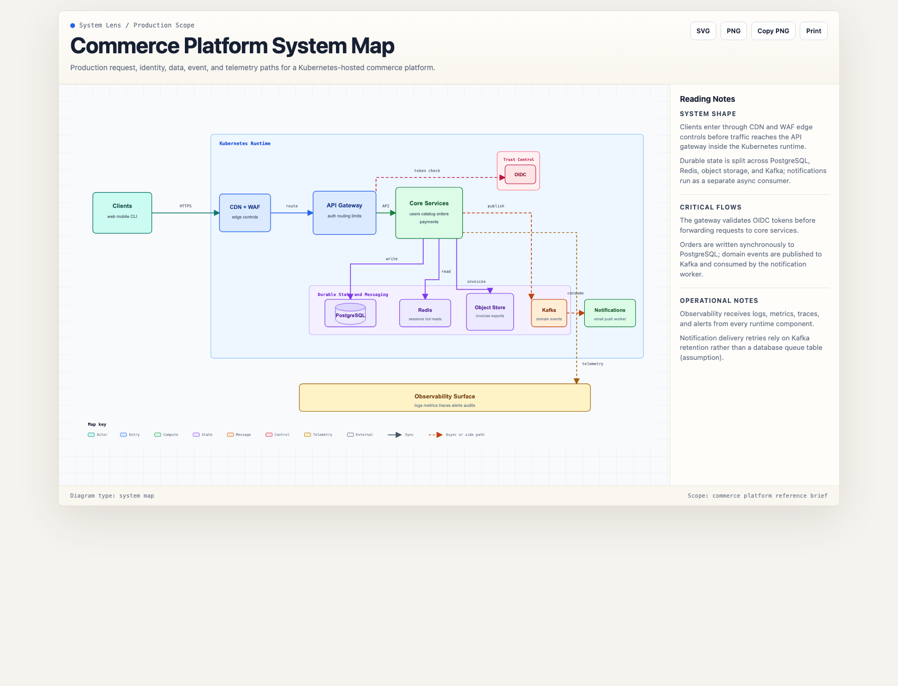
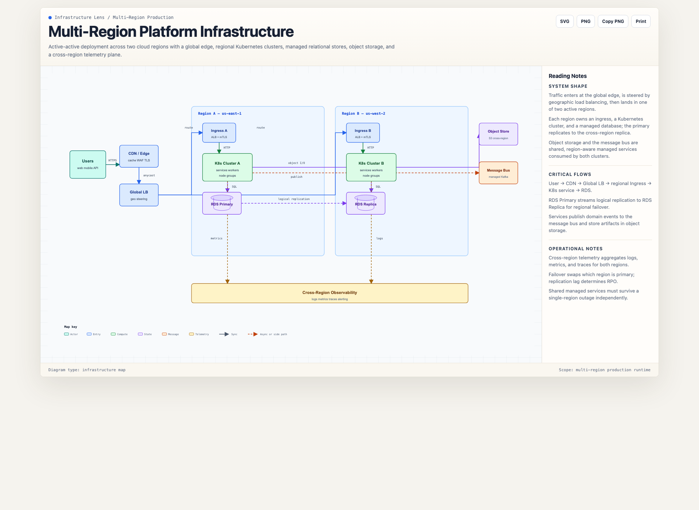
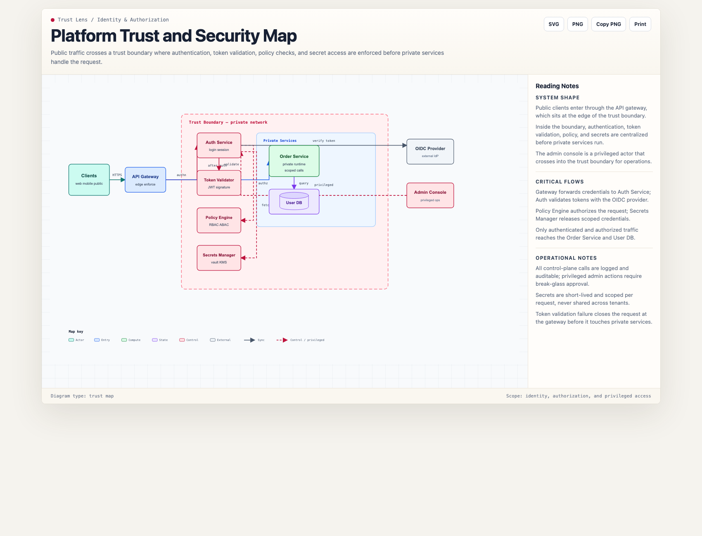
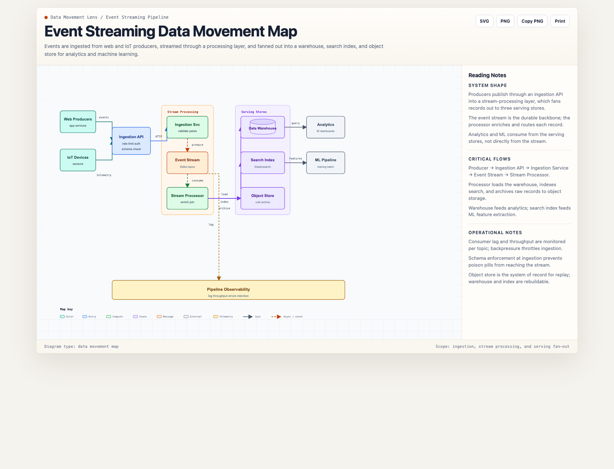
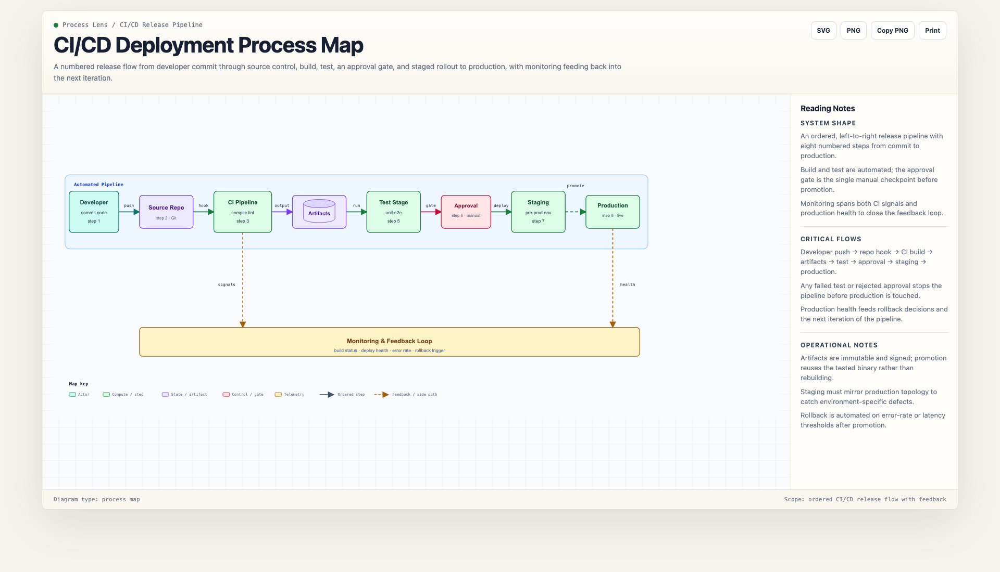

# 图表生成器 / Diagram Generator

图表生成器是一套平台中立的指令包，用于创建独立的专业技术系统图。它将架构简报、代码库笔记、部署描述、信任边界叙述和流程说明，转换为单个可在浏览器中打开的 HTML 文件（内联 SVG）。

Diagram Generator is a platform-neutral instruction pack for creating standalone technical system maps. It turns architecture briefs, codebase notes, deployment descriptions, trust-boundary narratives, and process explanations into a single browser-openable HTML file with inline SVG.

该包面向 Claude、Codex、Cursor、OpenCode、Windsurf、Gemini、GitHub Copilot、CodeBuddy 和 Hermes 等智能体环境。共享行为位于 `resources/` 中；平台文件是有意精简的适配器，将各平台路由到相同的生成与审计工作流。

The package is designed for agent environments such as Claude, Codex, Cursor, OpenCode, Windsurf, Gemini, GitHub Copilot, CodeBuddy, and Hermes. Shared behavior lives in `resources/`; platform files are intentionally thin adapters that route each platform to the same generation and audit workflow.

## 产出物 / What It Produces

生成器从七种视角（lens）中选择一种，渲染独立 HTML/SVG 图。以下是各视角的实例，均由简短简报渲染并通过 `scripts/check-diagram.mjs` 校验。

The generator picks one of seven lenses and renders a standalone HTML/SVG map. Below are examples of the lenses in action, each rendered from a short brief and validated with `scripts/check-diagram.mjs`.

> 下方示例图片托管于 GitHub。`docs/*.png` 和 `LICENSE` 文件属于源仓库；某些打包目标（如 SkillHub）会从分发包中剥离图片和许可证文件。
>
> Example images below are hosted on GitHub. The `docs/*.png` and `LICENSE` files are part of the source repository; some packaging targets (e.g. SkillHub) strip images and license files from the distributed bundle.

### 系统视角 / System lens



服务关系、用户入口、存储归属、外部集成和运维上下文。

Service relationships, user entry points, storage ownership, external integrations, and operational context.

### 基础设施视角 / Infrastructure lens



区域、集群、网络、网关、托管服务、对象存储、队列、容器和部署位置。

Regions, clusters, networks, gateways, managed services, object stores, queues, containers, and deployment placement.

### 信任边界视角 / Trust lens



身份提供方、公有/私有边界、特权操作、密钥、策略检查、令牌校验和管理路径。

Identity providers, public/private boundaries, privileged operations, secrets, policy checks, token validation, and administrative paths.

### 数据流动视角 / Data movement lens



摄取、复制、事件流、持久记录、转换、搜索索引、导出和报表。

Ingestion, replication, event streams, durable records, transformations, search indexes, exports, and reporting.

### 流程视角 / Process lens



Ordered interactions, approval chains, incident response, automation pipelines, and sequence-like flows.

Also supported: **implementation maps** (repository-derived stages, script execution chains, generated artifacts) and **deployment placement maps** (workload-to-infra allocation).

## 输出契约 / Output Contract

Default output is `html-first`: one standalone `.html` file with:

- inline SVG
- embedded CSS
- no external runtime or network dependency
- SVG download
- PNG download
- PNG copy when the browser supports it
- print/PDF support
- a notes rail for system shape, critical flows, and operational notes

Draw.io XML is optional and should only be requested when editability in draw.io or Confluence draw.io is part of the workflow.

## 目录结构 / Directory Layout

```text
diagram-generator/
├── README.md
├── SKILL.md
├── AGENTS.md
├── GEMINI.md
├── COPILOT-INSTRUCTIONS.md
├── CODEBUDDY.md
├── HERMES.md
├── LICENSE
├── agents/
│   └── openai.yaml
├── resources/
│   ├── generation-rules.md
│   ├── diagram-ir.md
│   └── template.html
├── scripts/
│   └── check-diagram.mjs
├── examples/
│   ├── architecture-brief.md
│   ├── codex-cli-example.txt
│   ├── codex-smoke-test-prompt.md
│   ├── drawio-mode-prompt.md
│   └── portable-agent-smoke-test-prompt.md
├── docs/
│   ├── example-system-map.png
│   ├── example-infrastructure-map.png
│   ├── example-trust-map.png
│   ├── example-data-movement-map.png
│   └── example-process-map.png
├── tests/
│   ├── platform-smoke-tests/
│   └── fixtures/
│       ├── example-commerce-system-map.html
│       └── bad-injected-defects.html
└── RELEASE_CHECKLIST.md
```

## Installation

下方按平台给出安装方式：核心是把本目录放到平台的技能/指令目录，并保证 `resources/` 可访问。中文环境同样适用，触发词见 SKILL.md。

Install per platform below. The key is to place this directory in the platform's skills/instruction folder and keep `resources/` accessible.

### Claude

Place or link this directory under a Claude skills folder:

```bash
mkdir -p ~/.claude/skills
ln -s /absolute/path/to/diagram-generator ~/.claude/skills/diagram-generator
```

Then ask:

```text
Use the diagram-generator skill to create a system map from this brief:

[paste brief]
```

### Codex, Cursor, OpenCode, Windsurf

Use `AGENTS.md` as the project instruction source and keep `resources/` available. The adapter points these platforms to the shared files, lens/output-mode selection, placeholder replacement, and the final audit. For Codex skill-style use:

```bash
mkdir -p ~/.codex/skills
ln -s /absolute/path/to/diagram-generator ~/.codex/skills/diagram-generator
```

### Gemini

Use `GEMINI.md` as the Gem or project instruction. Add `resources/generation-rules.md`, `resources/diagram-ir.md`, and `resources/template.html` as project knowledge when direct file access is unavailable.

### GitHub Copilot

Use `COPILOT-INSTRUCTIONS.md` as the custom instruction source, or copy its content into a repository instruction file.

### CodeBuddy

Use `CODEBUDDY.md` as the workspace rule file.

### Hermes

Use `HERMES.md` as the task specification and keep `resources/` available in the workspace.

## 使用模式 / Usage Pattern

1. Provide a brief or ask the agent to inspect a codebase.
2. Ask for the lens you want: system, implementation, infrastructure, trust, data movement, deployment, or process.
3. Generate an `html-first` artifact unless draw.io editability is explicitly needed.
4. Ask for a visual audit pass before publishing.

## 冒烟测试 / Smoke Tests

Platform-specific smoke prompts live in `tests/platform-smoke-tests/`.

Use them before publishing or after changing `resources/`:

- `claude.md`
- `codex.md`
- `gemini.md`
- `copilot.md`
- `codebuddy.md`
- `agents.md` for Cursor, OpenCode, Windsurf, and similar agents

Each smoke test checks that the agent uses `html-first`, follows the atlas-style template, keeps draw.io hidden by default, emits a notes rail without placeholder text, and can preserve unrelated content when revising an existing diagram.

## 输出检查器 / Output Checker

每个生成的产物在返回前必须通过零依赖校验器：

Every generated artifact must pass the zero-dependency validator before it is returned:

```bash
node scripts/check-diagram.mjs <output-file.html>
```

它校验占位符清除、notes 栏存在、自包含性、标记完整性、IR 几何（节点边界、重叠、连线端点、区域边界、区域包含且每边至少 10px 间距）、`data-node-id`/`data-edge-id` 与 IR 的交叉核对，以及可选的 `labelAnchor` 重叠检查。警告不阻断；错误以退出码 1 结束。

It verifies placeholder removal, notes-rail presence, self-containment, marker integrity, IR geometry (node bounds, overlaps, edge endpoints, region bounds, region containment with a minimum 10px gutter on every side), `data-node-id`/`data-edge-id` cross-checks against the IR, and optional `labelAnchor` overlap checks. Warnings do not block; errors exit 1.

### 错误码 / Error codes

Every checker message carries a stable, machine-greppable code prefix (`[Exxx]` errors, `[Wxxx]` warnings) so callers can classify failures without parsing prose:

| Code | Category | Notes |
|------|----------|-------|
| E001 | Usage | No input path given |
| E002 | IR parse | `#diagram-ir` slot is not valid JSON |
| E003 | Regions | Region ids/bounds/containment violations |
| E004 | IR structure | Missing/duplicate ids, missing nodes/edges arrays |
| E005 | Bounds | Node/region bounds invalid or outside the viewBox |
| E006 | Node overlap | Two node bounds intersect |
| E007 | Edge references | Missing or unknown source/target node |
| E008 | SVG–IR mismatch | `data-node-id`/`data-edge-id` not cross-consistent |
| E009 | Markers | Undefined marker reference or fill mismatch |
| E010 | Placeholder | Template placeholder text still present |
| E011 | Notes rail | `<aside class="notes">` missing |
| E012 | Self-containment | External or relative asset reference |
| E013 | Label anchor | `labelAnchor` invalid or sitting on a node |
| E014 | Connector geometry | Endpoint off-node, path through node, border-hugging |
| E099 | Uncategorized | Any error not yet mapped — report it so it gets a code |
| W001 | Legacy mode | No IR slot found; geometry checks skipped |
| W002 | Revise scope | `mode: revise` without `edit_scope` |
| W003 | Export UI | Optional toolbar / `#system-map` SVG absent |
| W004 | Path syntax | Unsupported SVG path syntax; endpoint geometry unchecked — review manually |

Exit codes: `0` when there are no errors (warnings allowed), `1` when any error exists.

A known-good reference artifact lives at `tests/fixtures/example-commerce-system-map.html` — it renders the Example Prompt brief below and passes the checker with zero errors and zero warnings. CI re-runs the checker against it on every push, so keep it green when changing checker rules or the template.

A known-bad fixture lives at `tests/fixtures/bad-injected-defects.html` — the known-good artifact with four injected defects (a template placeholder residue, a node whose bounds leave the viewBox, a region `contains` entry referencing a nonexistent node, and a node sitting flush against its region border). CI asserts the checker rejects it (non-zero exit) and reports all four defect classes; this proves the checker fails closed, not just that it passes a good sample.

## 质量指引 / Quality Guidance

以下规则保证生成结果可维护、可审计：

These rules keep generated output maintainable and auditable:

- Keep reusable behavior in `resources/generation-rules.md`.
- Keep the planning model in `resources/diagram-ir.md`.
- Keep the HTML/SVG/CSS base in `resources/template.html`.
- Keep platform files short; they should route the agent to the shared resources instead of restating them.
- Keep platform adapters synchronized with `SKILL.md` when required behavior changes.
- Use a two-step workflow for smaller-context models: first normalize the system into actors, components, stores, flows, and risks; then generate the final HTML from that normalized plan.
- For existing-diagram edits, prefer local coordinate and connector changes over full regeneration.
- Treat draw.io XML as an export adapter, not the default rendering target.

## 输出模式 / Output Modes

### `html-first`

The default mode. Prioritize visual clarity, readable labels, correct connectors, and a polished standalone HTML artifact.

Prompt:

```text
Create a system map for this platform:

[brief]
```

### `html + drawio xml`

Experimental and opt-in. Use when the user wants a browser-viewable artifact plus model-generated draw.io XML. Import-test the XML in draw.io before relying on it.

Prompt:

```text
Create a system map in html + drawio xml mode:

[brief]
```

### `drawio-first`

Planned. This mode is not production-ready until dedicated mxGraphModel rules, a template, and import validation are included.

## 示例提示词 / Example Prompt

```text
Create a standalone HTML system map for:

- Web and mobile clients enter through a CDN and API gateway.
- Backend services include users, catalog, orders, payments, and notifications.
- PostgreSQL stores transactional records.
- Redis caches sessions and hot catalog reads.
- Kafka carries order-created and payment-completed events.
- Object storage keeps invoices and exports.
- An external OIDC provider handles identity.
- Everything runs in Kubernetes behind ingress.

Use the default html-first mode. Keep visible text in English.
```

## 设计原则 / Design Principles

图表应解释行为，而不只是罗列组件。以下是核心原则：

A diagram should explain behavior, not merely inventory components. Core principles:

- A diagram should explain behavior, not merely inventory components.
- Use one abstraction level per artifact.
- Show ownership boundaries, durable state, async movement, trust controls, and operational watchpoints.
- Keep the main path readable before adding secondary paths.
- Prefer concise labels and put longer explanations in the notes rail.
- Do not rely on external images, fonts, scripts, or build tools.

## 发布 / Publishing

Before publishing, remove local smoke-test outputs (the checked-in fixture under `tests/fixtures/` stays) and run `RELEASE_CHECKLIST.md`.

## FAQ & Common Pitfalls

以下是使用中最常见的问题及其处理方式。中文环境下可直接用对应触发词生成图表，标签和注释语言跟随用户偏好。

The most common issues and how to resolve them. In Chinese contexts, use the corresponding trigger phrases; labels and notes follow the user's preferred language.

**Q: The checker reports an edge collinear with a node or region border. What do I do?**
A: Reroute the connector so it exits a node edge perpendicularly and travels in the free space between nodes. Never run a connector along the outer edge of its own source or target node, and avoid segments that share more than ~12 px with any region border.

**Q: A node overlaps a region it should sit inside.**
A: The checker enforces a 10 px gutter between every node and the region border. Shrink the node or expand the region; do not place nodes flush against a border.

**Q: draw.io XML fails to import in draw.io / Confluence.**
A: `html + drawio xml` mode is experimental. Always import-test the XML before relying on it. If editability is not required, use the default `html-first` mode, which is production-ready.

**Q: The generated HTML has leftover placeholder text.**
A: Every `{{...}}` token in `resources/template.html` must be replaced with concrete content. The checker fails on any residual placeholder. Do not leave template defaults in a delivered artifact.

**Q: Can I edit an existing diagram instead of regenerating it?**
A: Yes — prefer local coordinate and connector changes over full regeneration. Inspect the current artifact first and preserve unrelated nodes, notes, and color semantics.

**Q: The diagram looks cluttered.**
A: Use the notes rail for longer explanations instead of crowding the canvas. Keep one abstraction level per artifact and put secondary flows behind the main path.

**Q: Which lens should I pick?**
A: System for components/flows, infrastructure for deployment topology, trust for security boundaries, data movement for ingestion/streams, process for ordered pipelines, deployment for workload placement, implementation for code-derived stages. When unsure, start with a system map.

**Q: Why are images and LICENSE missing from my installed copy?**
A: Some distributors (e.g. SkillHub) strip PNG images and standalone LICENSE files from the package for security/format reasons. The canonical images and license are always available in the source GitHub repository.
